# OpenExtract

A free, open-source desktop application for extracting text messages, photos, voicemails, call history, contacts, and notes from iPhone/iPad backups.

**No cloud. No subscriptions. Your data stays on your computer.**

[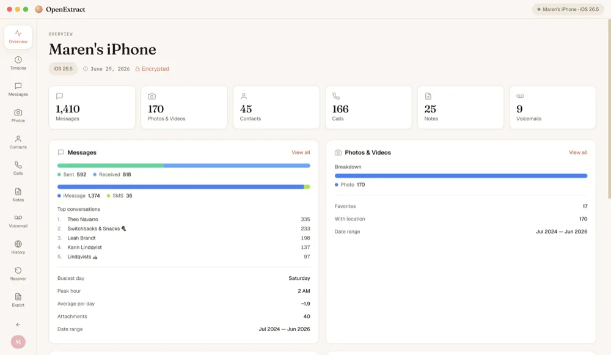](website/static/img/screens/overview-2000.webp)

## Features

- 💬 **Messages** — Browse iMessage/SMS conversations with chat-bubble UI
- 📷 **Photos & Videos** — Gallery view with thumbnails and bulk export
- 📞 **Voicemail** — Listen to voicemails with caller ID
- 📋 **Call History** — View calls with contact name resolution
- ❤️ **Health** — Steps, sleep, heart rate, weight and workouts, with charts and CSV export (needs an encrypted backup)
- 👤 **Contacts** — Browse and export your address book
- 📝 **Notes** — Read and export your iOS notes
- 🔒 **Encrypted Backups** — Full support for password-protected backups
- 📤 **Export** — Save conversations as PDF, HTML, CSV, or plain text

## Writing

Essays on Medium about what your phone keeps, and what it's like to finally read it:

- **[The journal you never meant to keep](https://medium.com/@charles.west_98012/the-journal-you-never-meant-to-keep-c1858cb5a065)** (October 2026): your phone has been keeping a more honest journal than the one you'd write, and how to read it like one.
- **[The Fortress of Nothing Matters](https://medium.com/@charles.west_98012/the-fortress-of-nothing-matters-65a7b01aeaf6)** (April 2026): what 17,518 extracted text messages revealed when analyzed at scale, and what data-as-mirror can show that introspection can't.
- **[Your iPhone Has Been Writing Your Diary. You Just Can't Read It Yet.](https://medium.com/@charles.west_98012/your-iphone-has-been-writing-your-diary-you-just-cant-read-it-yet-30cafde69261)** (March 2026): what it feels like to finally hold years of your own messages, photos and voicemails in a readable form.

More on [Medium](https://medium.com/@charles.west_98012) and the [OpenExtract blog](https://www.openextract.app/blog).

## Screenshots

These use a made-up test backup, so none of the people or messages are real. Click any screenshot to see it full size.

<table>
  <tr>
    <td width="50%" valign="top">
      <a href="website/static/img/screens/timeline-2000.webp">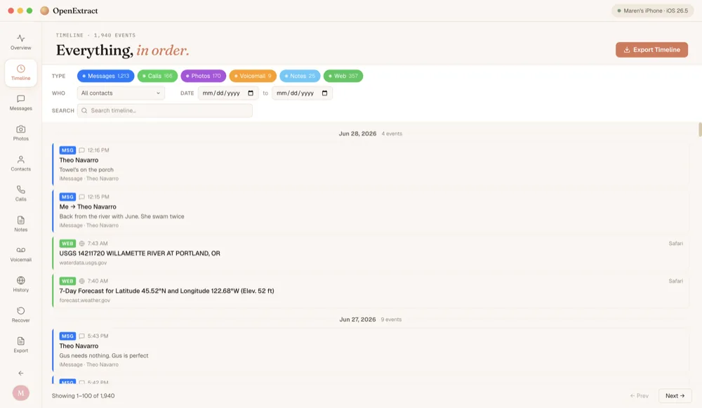</a>
      <br><b>Timeline</b>: messages, calls, photos, voicemails, notes and web visits in one list, by date.
    </td>
    <td width="50%" valign="top">
      <a href="website/static/img/screens/messages-2000.webp">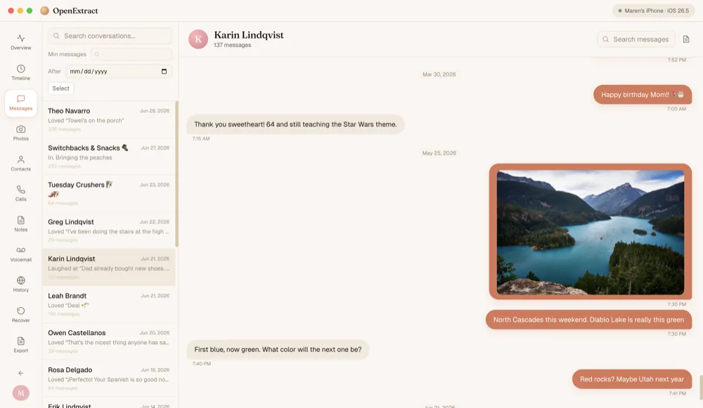</a>
      <br><b>Messages</b>: read any conversation, with the photos that were sent in it.
    </td>
  </tr>
  <tr>
    <td width="50%" valign="top">
      <a href="website/static/img/screens/group-chat-2000.webp">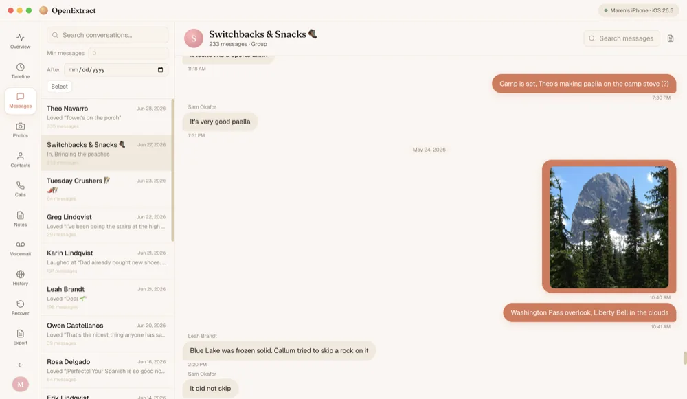</a>
      <br><b>Group chats</b>: group threads show who said what.
    </td>
    <td width="50%" valign="top">
      <a href="website/static/img/screens/photos-2000.webp">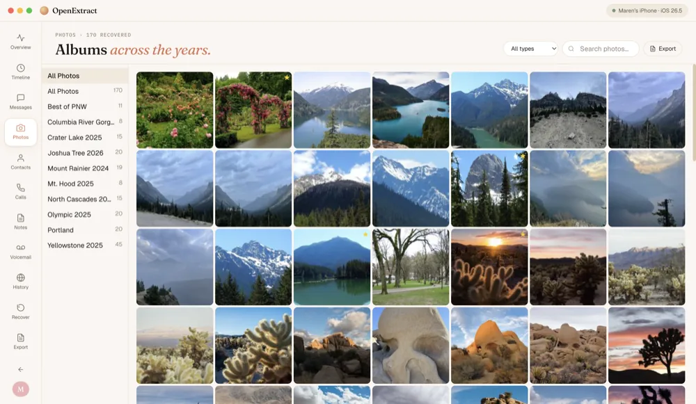</a>
      <br><b>Photos</b>: the whole camera roll, with favorites starred.
    </td>
  </tr>
  <tr>
    <td width="50%" valign="top">
      <a href="website/static/img/screens/album-2000.webp">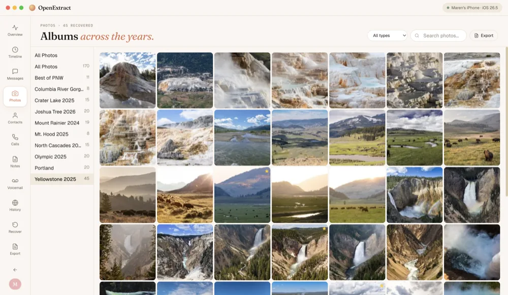</a>
      <br><b>Albums</b>: the albums made on the phone, kept as they were.
    </td>
    <td width="50%" valign="top">
      <a href="website/static/img/screens/contacts-2000.webp">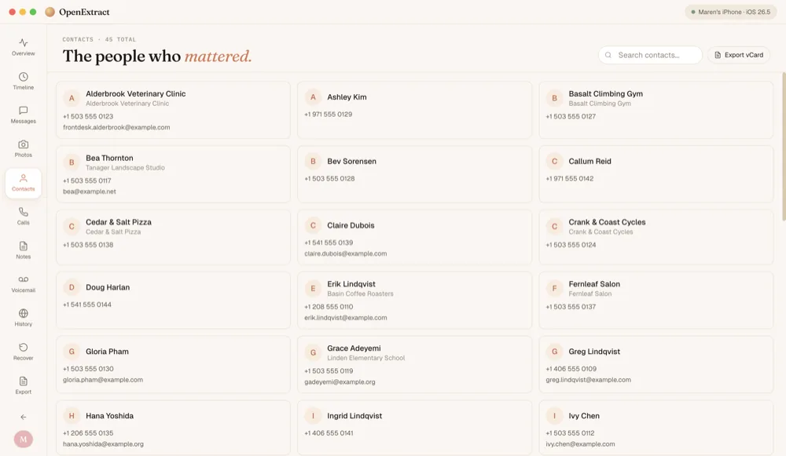</a>
      <br><b>Contacts</b>: the address book, with an Export vCard button.
    </td>
  </tr>
  <tr>
    <td width="50%" valign="top">
      <a href="website/static/img/screens/calls-2000.webp">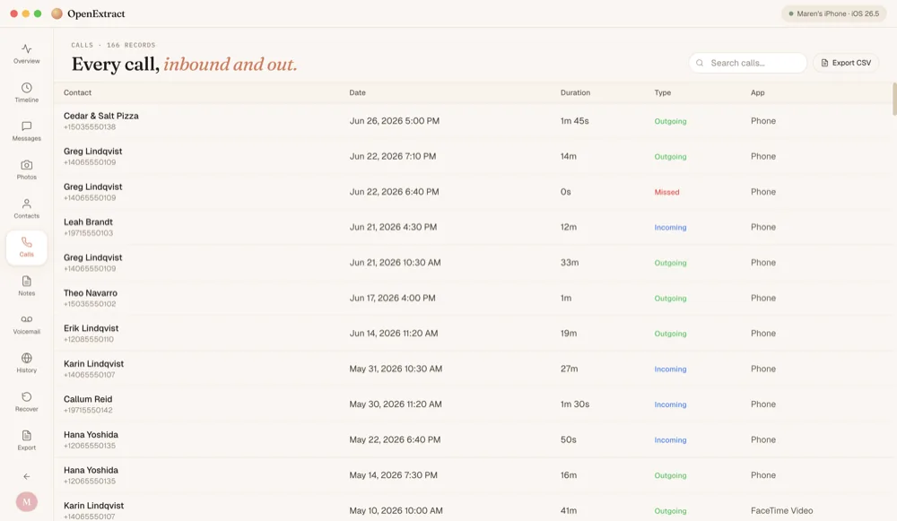</a>
      <br><b>Call history</b>: every call with its date, length and direction, including FaceTime.
    </td>
    <td width="50%" valign="top">
      <a href="website/static/img/screens/notes-2000.webp">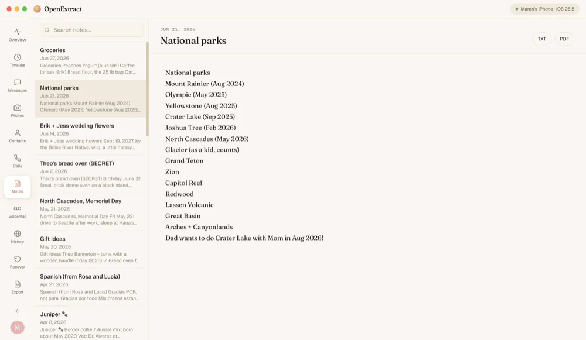</a>
      <br><b>Notes</b>: read any Apple Note and save it as text or PDF.
    </td>
  </tr>
  <tr>
    <td width="50%" valign="top">
      <a href="website/static/img/screens/voicemail-2000.webp">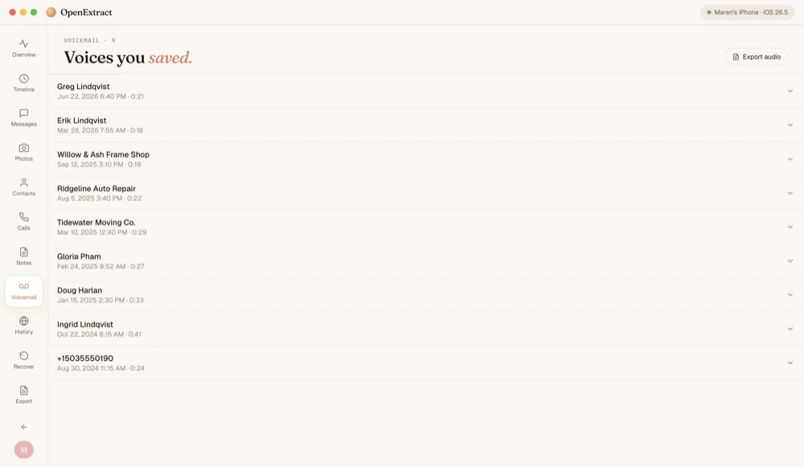</a>
      <br><b>Voicemail</b>: saved voicemails with who called and when. Play them or export the audio.
    </td>
    <td width="50%" valign="top">
      <a href="website/static/img/screens/history-2000.webp">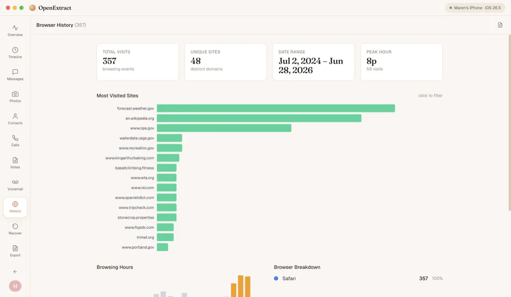</a>
      <br><b>Browser history</b>: Safari visits, the sites visited most, and the hours you browse.
    </td>
  </tr>
</table>

## Download

Get the latest version from [openextract.app](https://www.openextract.app/#download) or [GitHub Releases](https://github.com/charleswest775/openextract/releases/latest).

### Linux

- **Ubuntu, Debian, Mint, Pop!_OS:** download the `.deb` and open it, or install it from a terminal, then start OpenExtract from your app menu:
  ```bash
  sudo apt install ./openextract_*_amd64.deb
  ```
- **Other distros:** use the `.AppImage` (`chmod +x` it first). AppImages need FUSE 2, which Ubuntu 22.04 and later no longer install by default. If it fails with `dlopen(): error loading libfuse.so.2`, install FUSE 2 (`libfuse2t64` on Ubuntu 24.04+, `libfuse2` on Ubuntu 22.04 and Debian, `fuse-libs` on Fedora, `fuse2` on Arch), or run it without FUSE:
  ```bash
  ./OpenExtract-*.AppImage --appimage-extract-and-run
  ```

## Quick Start

### Prerequisites

- **Node.js 18+** and npm
- **Python 3.11+**
- An iTunes/Finder backup of your iPhone on this computer

### Setup

OpenExtract's parsing engine lives in a separate library,
[ios-backup-core](https://github.com/charleswest775/ios-backup-core), which
`python/requirements.txt` installs from a **sibling folder**. Clone both repos
side by side, or `pip install` will fail and the app will report
`ModuleNotFoundError: No module named 'ios_backup_core'`:

```
your-dev-folder/
├── openextract/
└── ios-backup-core/
```

```bash
# Clone both repos side by side
git clone https://github.com/charleswest775/ios-backup-core.git
git clone https://github.com/charleswest775/openextract.git
cd openextract

# Install Node dependencies
npm install

# Install Python dependencies
cd python
pip install -r requirements.txt
cd ..

# Start the development server
npm run dev
```

This will launch Vite (React dev server) and Electron together. The app will auto-detect iPhone backups in the default locations:

- **macOS:** `~/Library/Application Support/MobileSync/Backup/`
- **Windows:** `%APPDATA%\Apple Computer\MobileSync\Backup\`

> **macOS:** the MobileSync folder is protected by macOS privacy controls, so OpenExtract
> needs **Full Disk Access** to read it (System Settings → Privacy & Security → Full Disk
> Access → turn on OpenExtract, then quit and reopen it). The app will prompt you with a
> shortcut to that setting if access is missing. When running from source with `npm run dev`,
> grant Full Disk Access to your terminal app instead.

### Creating a Backup

If you don't have a backup yet:

1. Connect your iPhone to your computer via USB
2. Open **Finder** (macOS) or **iTunes/Apple Devices** (Windows)
3. Select your device
4. Check "Encrypt local backup" (recommended — gives access to more data)
5. Click "Back Up Now"

## Architecture

```
Electron (window, menus, file dialogs)
    ↕ IPC
React Frontend (UI components)
    ↕ JSON-RPC over stdin/stdout
Python Sidecar (backup parsing, SQLite queries, decryption)
```

The Python sidecar handles all backup reading and is bundled as a standalone executable for distribution (via PyInstaller). Users never need to install Python.

## Project Structure

```
openextract/
├── electron/          # Electron main process + sidecar manager
├── src/               # React frontend
│   ├── components/    # UI components
│   ├── hooks/         # React hooks for state management
│   └── lib/           # Utilities (IPC client, date formatting)
├── python/            # Python sidecar engine
│   ├── main.py        # JSON-RPC server
│   ├── backup.py      # Backup discovery & management
│   ├── messages.py    # SMS/iMessage extraction
│   ├── contacts.py    # Address book parsing
│   ├── photos.py      # Photo/video extraction
│   ├── voicemail.py   # Voicemail extraction
│   ├── calls.py       # Call history parsing
│   └── notes.py       # Notes extraction
└── scripts/           # Build scripts
```

## Building for Distribution

```bash
# Bundle the Python sidecar
cd python
pyinstaller --onefile --name openextract-engine main.py
cd ..

# Package the Electron app
npm run package
```

Output will be in the `release/` directory.

## Privacy

OpenExtract runs 100% locally. Your backup data never leaves your computer. The source code is fully auditable — that's the point of being open source.

The only network request the app makes is an update check: it asks GitHub for the latest release's version file. It asks you once before checking automatically, you can turn it off in Settings, and it never sends anything about you or your backups. Updates download only when you click Update.

## License

MIT — use it however you want.

## Contributing

PRs welcome! Key areas where help is needed:

- Testing across iOS versions (schema changes between versions)
- Windows testing and packaging
- Photo gallery UI
- PDF export with proper formatting
- Accessibility improvements
